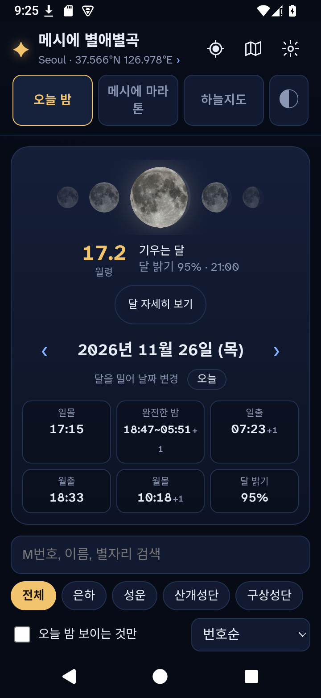
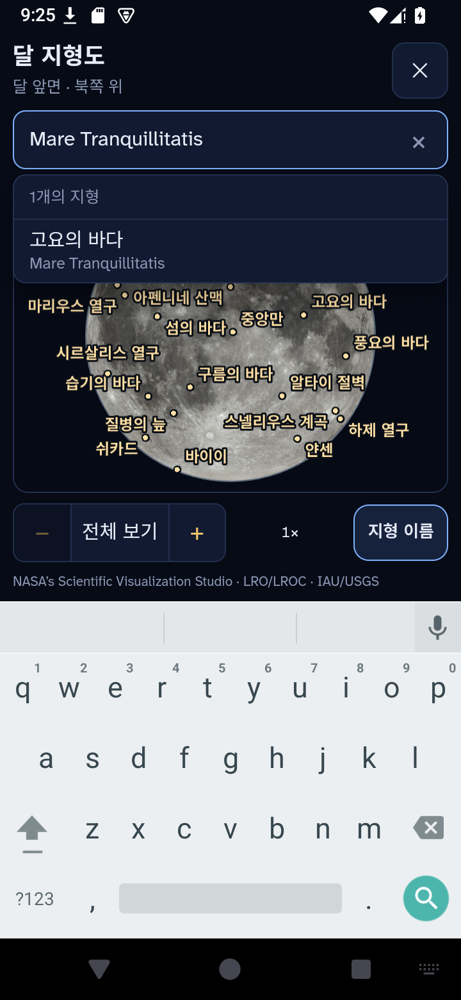
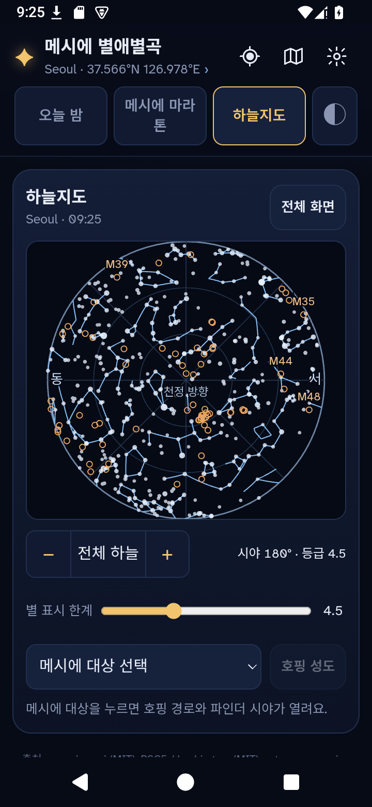
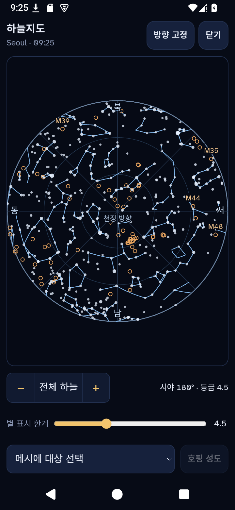
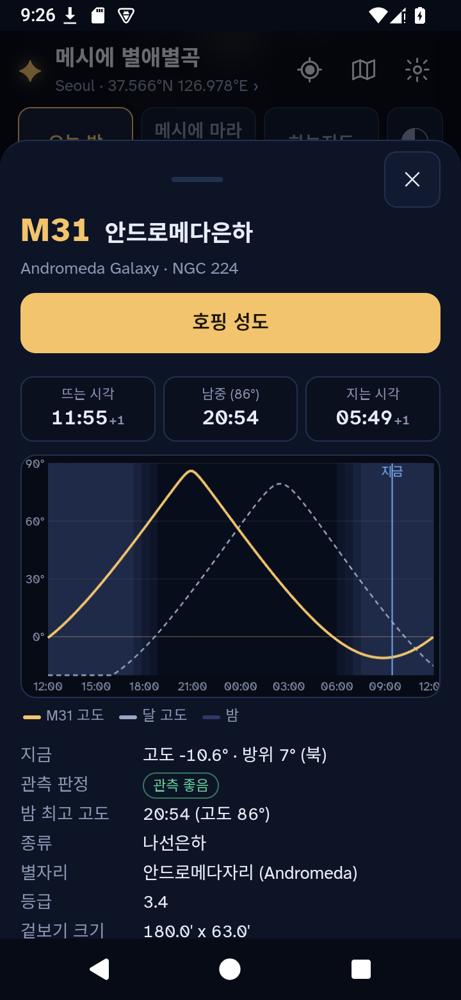
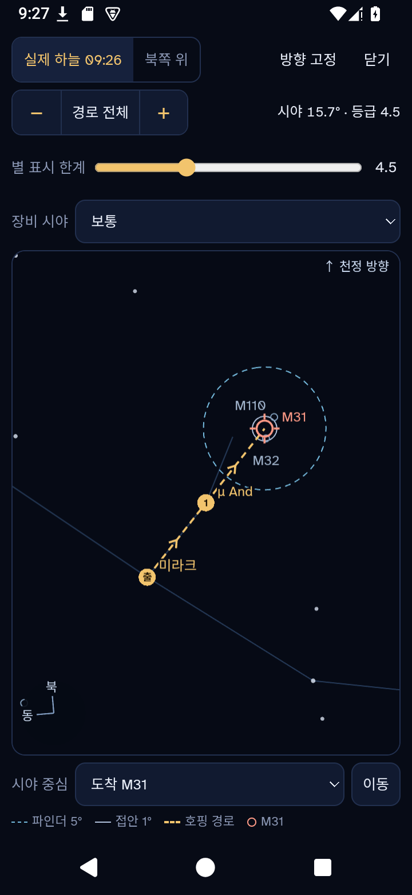
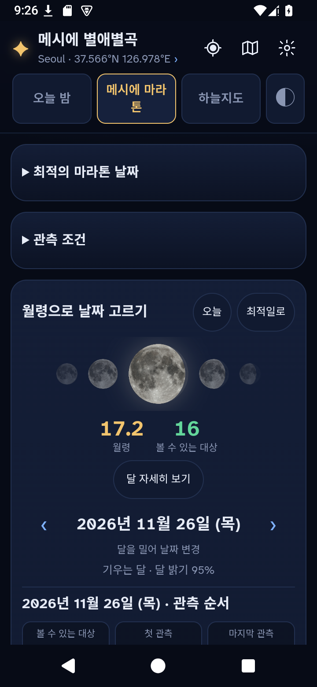
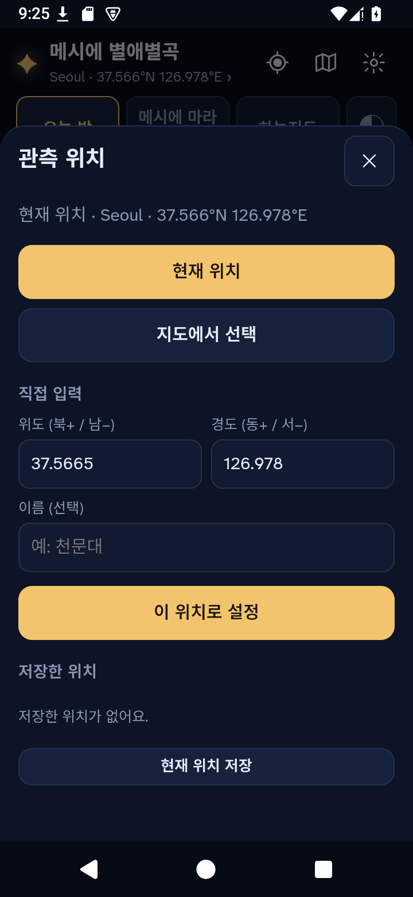
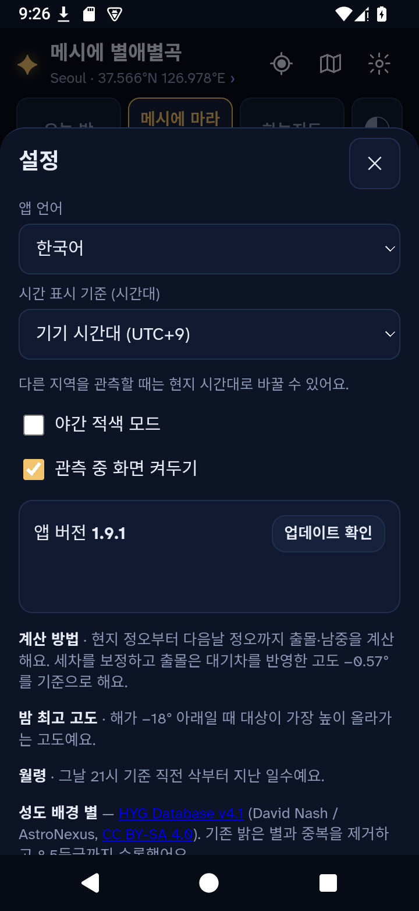

<!--
작성일 2026-11-27
작성자 jsk
제목 메시에 별애별곡 v1.9.1 사진 사용법
요약 실제 Android 화면으로 설치, 관측지 설정, 달·하늘보기, 메시에 관측과 기록 방법을 안내함.
업무내용 화면별 버튼과 손가락 조작, 시간·등급 표시의 의미, 연결이 없을 때의 사용 방법을 기록함.
-->

# 메시에 별애별곡 사진 사용법

Android **v1.9.1** 한국어 화면을 기준으로 설명합니다. 사진에는 예시 관측지와 날짜가 표시되어 있습니다. 실제로 관측하기 전에는 화면 위의 위치와 시간대를 확인하세요.

[설치](#1-설치와-업데이트) · [오늘 밤](#2-오늘-밤에서-관측-대상-고르기) · [달 지형도](#3-달-지형도에서-이름으로-찾아보기) · [하늘지도](#4-하늘지도에서-별과-메시에-찾기) · [호핑 성도](#5-대상-상세와-호핑-성도-쓰기) · [마라톤](#6-마라톤-날짜-고르기와-관측-기록) · [관측 위치](#7-관측-위치-설정하기) · [설정](#8-설정과-오프라인-사용)

처음 관측한다면 **현재 위치** → **오늘 밤** → **오늘 밤 보이는 것만** → 관측 대상 선택 → **호핑 성도** 순서로 시작하세요. 이미 아는 대상은 **오늘 밤** 검색창에 `M31`처럼 번호를 입력해 바로 찾을 수 있습니다.

## 1. 설치와 업데이트

1. 안드로이드 폰의 브라우저에서 다운로드 목록을 열고 **메시에 별애별곡 · Conquer Messier → APK 다운로드**를 누릅니다. GitHub 로그인 없이 받을 수 있습니다. [앱 다운로드 목록](../../README.md)
2. 다운로드한 APK를 엽니다. Android가 설치 권한을 물으면 안내에 따라 APK를 연 브라우저나 파일 앱의 **이 출처의 앱 설치 허용**을 켭니다. 설치 화면으로 돌아와 **설치**를 누릅니다. Android 5.0 이상이 필요합니다.
3. 사용 중인 앱을 업데이트하려면 앱 오른쪽 위의 **설정** 아이콘을 열고 **업데이트 확인**을 누릅니다. 새 버전이 표시되면 **업데이트 내려받고 설치**를 누르고 Android 설치 화면에서 **업데이트**를 누릅니다. 앱 자체의 APK 설치 권한을 처음 묻는 경우 허용한 뒤 앱으로 돌아갑니다.

앱을 열었을 때 새 버전 알림이 보이면 **업데이트**로 곧바로 진행할 수 있습니다. 알림의 **×**를 닫았어도 **설정 → 업데이트 확인**에서 다시 확인할 수 있습니다. 기존 앱 위에 업데이트하면 저장한 위치와 관측 체크를 이어서 쓸 수 있습니다.

## 2. 오늘 밤에서 관측 대상 고르기

1. 상단의 **오늘 밤**을 누릅니다. 달 카드 아래의 **일몰**, **완전한 밤**, **일출**, **월출**, **월몰**을 확인합니다. 해의 고도가 −18°보다 낮아지면 완전한 밤으로 표시합니다. 시각 뒤의 **+1**은 선택한 날짜의 다음날을 뜻합니다.
2. **‹ / ›**는 날짜를 하루씩 바꿉니다. 가운데 **날짜**를 눌러 달력에서 날짜를 직접 선택하거나 **오늘**을 눌러 현재 날짜로 돌아갑니다.
3. 한국어 화면에서 달 사진을 **왼쪽으로 밀면 미래**, **오른쪽으로 밀면 과거**입니다. 양옆의 작은 달 사진을 눌러 1일 또는 2일씩 이동할 수도 있습니다. 미는 동안 가운데 달 원반 위치는 고정되고 날짜와 위상이 바뀝니다. 손을 떼면 관측 목록을 다시 계산합니다.
4. **M번호, 이름, 별자리 검색**에 `M31`, `안드로메다`처럼 입력합니다. **전체 / 은하 / 성운 / 산개성단 / 구상성단**으로 종류를 고르고, 검색 결과가 적으면 **전체**를 눌러 종류 제한을 풉니다.
5. **오늘 밤 보이는 것만**은 선택한 날의 완전한 밤에 10° 이상 올라가는 대상을 남깁니다. 정렬은 **번호순 / 남중 시각순 / 뜨는 시각순 / 밤 고도 높은 순** 중에서 고릅니다. 원하는 대상 행을 누르면 상세 화면이 열립니다.

**남중**은 천체가 자오선을 지나는 시각입니다. **밤 최고 고도**는 그날의 어두운 시간 안에서 찾은 가장 높은 고도입니다. 달 카드의 **월령**은 현지 21시 기준으로 직전 삭부터 지난 일수이고, **달 밝기**의 %는 달 원반에서 밝게 보이는 부분의 비율입니다.

## 3. 달 지형도에서 이름으로 찾아보기

1. **오늘 밤**이나 **메시에 마라톤**의 달 카드에서 **달 자세히 보기**를 누릅니다. 달 앞면을 북쪽이 위인 방향으로 보여 줍니다.
2. **지형 이름 검색**에 `고요의 바다`, `비의 바다`, `티코` 또는 `Mare Tranquillitatis`처럼 입력합니다. 원하는 결과를 누르면 지형이 있는 곳으로 이동하며 확대됩니다. 검색 결과가 많을 때는 이름을 더 입력하세요.
3. 지도 위 지형 이름을 직접 눌러도 선택할 수 있습니다. 선택한 이름과 지름 자료가 화면 아래에 나옵니다. 한국어 이름이 있는 지형은 한글 이름과 공식 이름을 함께 확인할 수 있습니다.

- **− / +** 또는 두 손가락으로 1~8배까지 축소·확대합니다. 확대 후 **한 손가락으로 끌기**는 달 사진 안에서 보는 위치를 옮기는 동작입니다.
- **전체 보기**는 처음 배율로 돌아가고 검색과 선택을 지웁니다. **지형 이름**은 지도에 표시되는 이름을 켜고 끕니다.
- 검색창의 작은 **×**는 검색어를 지우고, 화면 오른쪽 위 **✕**는 달 지형도를 닫습니다. 달 사진과 이름 검색은 인터넷 연결 없이 쓸 수 있습니다.

## 4. 하늘지도에서 별과 메시에 찾기

1. 상단에서 **하늘지도**를 엽니다. 설정한 관측지와 현재 시각의 지평선 위 하늘을 표시합니다. 관측지 이름이나 좌표와 시각은 지도 위에 표시됩니다.
2. **한 손가락으로 끌면** 보는 방향이 이동합니다. **두 손가락을 벌리거나 오므리면** 처음 두 손가락을 놓은 지점을 기준으로 확대·축소합니다. **+ / −**는 화면 가운데를 기준으로 확대·축소합니다. **전체 하늘**은 천정 중심의 처음 시야로 돌아갑니다.
3. 더 넓게 보려면 **전체 화면**을 누릅니다. 세로 또는 가로로 폰을 둔 뒤 **방향 고정**을 누르면 그 방향을 유지합니다. 다시 나타나는 **세로 고정 해제** 또는 **가로 고정 해제**를 누르거나 **닫기**로 전체 화면을 나가면 기기의 기본 회전 동작으로 돌아갑니다.
4. **별 표시 한계**를 바꾸면 화면에 그릴 별의 밝기 범위가 달라집니다. 숫자를 높일수록 희미한 별을 더 표시하며, 넓은 시야에서는 실제 표시 등급을 자동으로 낮춥니다. 지도 아래의 **시야**와 **등급**을 같이 확인하세요. 희미한 별을 더 보려면 한계를 높이고 해당 지역을 확대합니다.
5. 지도 위의 메시에 번호나 표식을 누르면 해당 대상의 호핑 성도가 열립니다. 목록으로 찾으려면 **메시에 대상 선택**에서 대상을 고른 뒤 옆의 **호핑 성도**를 누릅니다.

## 5. 대상 상세와 호핑 성도 쓰기

대상 상세에서 **뜨는 시각 / 남중 / 지는 시각**, 별자리, 등급, 겉보기 크기 등을 확인합니다. 고도 그래프에서는 대상과 달의 고도 변화, 어두운 시간대를 한눈에 볼 수 있습니다. 선택한 낮부터 다음날 낮까지의 범위에 현재가 들어 있으면 **지금**의 고도와 방위도 표시됩니다.

1. 상세 맨 위 **호핑 성도**를 눌러 전체 화면으로 엽니다. 밝은 출발 별부터 목표까지 번호와 화살표를 따라갑니다. **시야 중심**의 메뉴에서 출발 별, 중간 별, 도착 대상을 고르면 그 지점으로 이동합니다. **이동**을 눌러 선택한 단계에 다시 맞출 수 있습니다.
2. **파인더 5°**와 **접안 1°** 원을 실제 장비에서 보이는 별 배치와 비교합니다. 숫자는 원의 지름이며 사용하는 장비의 실제 시야는 다를 수 있습니다.
3. **실제 하늘**은 표시된 시각과 관측지에 맞춰 천정 쪽을 위로 놓습니다. 책이나 일반 성도와 맞추려면 **북쪽 위**를 누릅니다. 망원경의 시야가 뒤집혀 보이면 **장비 시야**에서 **보통 / 좌우 반전 / 180° 회전 / 상하 반전**을 골라 맞춥니다. 장비 시야의 반전과 휴대폰의 **방향 고정**은 서로 다른 조작입니다.
4. **− / +**, 두 손가락으로 배율을 바꾸고 한 손가락으로 끌어 이동합니다. **경로 전체**는 출발 별부터 목표까지 한 화면에 다시 맞춥니다. **별 표시 한계** 설정은 하늘지도와 공유됩니다. **닫기**를 누르면 상세로 돌아가고, 상세 아래의 성도에서는 **전체 화면**을 눌러 다시 크게 열 수 있습니다.

## 6. 마라톤 날짜 고르기와 관측 기록

### 날짜와 관측 조건 고르기

1. **메시에 마라톤**을 누르면 선택한 날짜의 **관측 순서**가 표시됩니다. **관측 조건**을 펴서 **최소 고도**, **대상당 시간**, **박명 허용**을 조절합니다. 산이나 건물로 낮은 하늘이 가려지면 최소 고도를 높이세요. 박명 허용을 **관대**로 설정하면 해 뜨기 전이나 진 뒤에 밝은 대상을 찾을 수 있다고 가정합니다.
2. 날짜를 알고 있다면 **계획할 날짜**에서 고른 뒤 **이 날짜로 계획**을 누릅니다. 달 위상을 보며 고르려면 **월령으로 날짜 고르기**의 달 사진을 좌우로 밀거나 **‹ / ›**를 누릅니다. **오늘**은 당일 계획을 보여 줍니다.
3. 날짜를 추천받으려면 **최적의 마라톤 날짜 → 최적일 검색**을 누릅니다. 앞으로 약 1년의 밤을 계산하며, 관측 가능 대상이 더 많은 날짜를 앞에 표시합니다. 대상 수가 같으면 달빛이 적은 날을 우선합니다. 검색 도중 **취소**할 수 있습니다.
4. 추천 날짜 행 또는 연간 그래프의 원하는 날짜를 누르면 그날의 계획이 열립니다. **최적일로**는 계산된 첫 추천 날짜로 이동합니다. 아직 검색한 결과가 없으면 연간 검색부터 시작합니다.

### 현장에서 순서 찾고 체크하기

1. 관측 순서에서 시각, 방향, 고도와 이전 대상에서 옮길 각도를 확인합니다. **⚠**는 낮거나 관측할 여유 시간이 적은 대상입니다. **놓치는 대상**을 펴면 낮은 고도, 박명, 달빛, 다른 관측과의 시간 겹침 등 이유를 확인할 수 있습니다.
2. **지금 차례로** 또는 **다음 예정**을 누르면 지금 볼 수 있거나 다음에 예정된 미완료 대상의 상세가 열립니다. 직접 순서를 고르려면 원하는 대상 행을 누릅니다. 상세에서 **관측 목표** 시각과 **볼 수 있는 시간**을 확인하세요.
3. 확인한 대상은 목록 왼쪽의 **✓**로 표시합니다. 마라톤에서 연 대상 상세와 호핑 성도에서도 **관측 체크**, **이전 대상**, **다음 대상**으로 진행할 수 있습니다. 실수로 체크했다면 같은 버튼을 한 번 더 누릅니다.
4. **완료** 숫자로 진행 상황을 확인합니다. 해당 날짜의 체크를 모두 지울 때는 **체크 초기화**를 누르고 확인 영역에서 다시 **체크 초기화**를 누릅니다. 계속 보관하려면 **취소**를 누릅니다.

## 7. 관측 위치 설정하기

- 화면 위쪽에서 **과녁 모양(현재 위치)**을 누르면 폰에서 좌표를 요청합니다. 처음 사용할 때 Android가 물으면 위치 권한을 허용하세요. 좌표를 구하지 못하면 기존 관측 위치를 유지합니다.
- 상단의 위치 이름이나 좌표를 누르면 **관측 위치**가 열립니다. **지도에서 선택** 버튼이나 상단의 접힌 지도 아이콘을 누르면 지도에서 고를 수 있습니다. 한 손가락으로 지도를 옮기고 **+ / −** 또는 두 손가락으로 확대·축소합니다. 관측할 곳을 눌러 표시와 좌표를 확인하고 **이 위치로 설정**으로 적용합니다. 지도 화면의 **직접 입력**은 좌표 입력으로 돌아가고 **✕**는 지도를 닫습니다.
- **직접 입력**에서는 위도(북쪽 `+`, 남쪽 `−`)와 경도(동쪽 `+`, 서쪽 `−`)를 넣습니다. 이름은 선택이며 입력 후 **이 위치로 설정**을 누릅니다.
- **현재 위치 저장**은 화면에 적용된 관측지를 **저장한 위치**에 추가합니다. 목록에서 이름을 누르면 해당 장소를 다시 적용하고, 항목 옆 **✕**는 저장 목록에서 그 항목을 지웁니다.

다른 나라의 장소를 고르면 현지와 표시 시각이 다를 수 있습니다. **설정 → 시간 표시 기준 (시간대)**에서 관측하는 날짜의 현지 UTC 오프셋을 직접 고르세요.

## 8. 설정과 오프라인 사용

- **앱 언어**는 원하는 언어로 바꾸거나 **기기 언어 사용**으로 돌아갑니다. 한국어, 영어, 중국어(간체), 힌디어, 스페인어, 아랍어, 프랑스어, 벵골어, 포르투갈어, 인도네시아어, 우르두어, 일본어를 지원합니다. 지원 목록에 없는 기기 언어는 영어로 표시됩니다. 기기 언어가 한국어가 아니면 Android 홈 화면에서 **Conquer Messier**를 찾으세요.
- **시간 표시 기준 (시간대)**는 **기기 시간대** 또는 수동 UTC 오프셋을 선택합니다. UTC 오프셋을 수동으로 고른 경우 그 관측 날짜에 맞는 값을 사용하세요.
- **야간 적색 모드**는 어두운 곳에서 화면 색을 적색 계열로 바꿉니다. 상단 탭 옆 **◐**로도 켜고 끌 수 있습니다. **관측 중 화면 켜두기**를 켜면 앱을 보는 동안 화면이 슬립으로 꺼지는 것을 막습니다.
- **앱 버전**으로 설치한 버전을 확인하고 **업데이트 확인**으로 새 버전을 확인합니다. 설정 아래쪽의 **계산 방법**, **밤 최고 고도**, **월령**, **성도 배경 별**에서 표시값의 기준과 자료 출처를 볼 수 있습니다. 사진으로 조작 순서를 다시 확인할 때는 이 사용법의 해당 화면 항목을 참고하세요.

인터넷이 없는 관측지에서는 미리 저장한 위치나 알고 있는 좌표를 선택하세요. 관측 시각 계산, 하늘지도, 호핑 성도와 달 지형 검색은 오프라인으로 작동합니다. 지리 지도 배경을 불러오거나 새 APK를 확인하고 받을 때는 인터넷 연결이 필요합니다.

## 화면이 예상과 다를 때

| 상황 | 확인할 항목 |
| --- | --- |
| 뜨는 시각이나 방향이 어긋나 보임 | 상단의 관측 위치와 시간대를 확인합니다. **오늘 밤**은 선택한 날짜의 현지 정오부터 다음날 정오까지 계산하고, **하늘지도**는 현재 시각을 사용합니다. |
| 찾던 메시에 대상이 목록에 없음 | 종류를 **전체**로 바꾸고 **오늘 밤 보이는 것만**을 끈 뒤 `M` 번호로 검색합니다. |
| 찾던 달 지형이 검색되지 않음 | 한국어 이칭이나 IAU 공식 이름으로 다시 검색합니다. 이 지도에는 달 앞면에서 보이는 지형 중심이 표시됩니다. |
| 성도의 별이 너무 적거나 많음 | **별 표시 한계**를 조절하고, 희미한 별은 해당 영역을 충분히 확대합니다. |
| 망원경과 성도가 좌우 또는 상하로 다름 | 호핑 성도의 **실제 하늘 / 북쪽 위**와 **장비 시야**의 반전·회전을 각각 확인합니다. |
| 위치나 지도 배경을 가져오지 못함 | 기기 위치와 앱 권한을 확인합니다. 연결을 사용할 수 없는 곳이면 **저장한 위치** 또는 **직접 입력**으로 진행합니다. |
| 앱에서 업데이트를 확인하지 못함 | 인터넷에 연결한 뒤 **설정 → 업데이트 확인**을 다시 누르거나, 공개 목록에서 APK를 받아 기존 앱 위에 설치합니다. [앱 다운로드 목록](../../README.md) |
